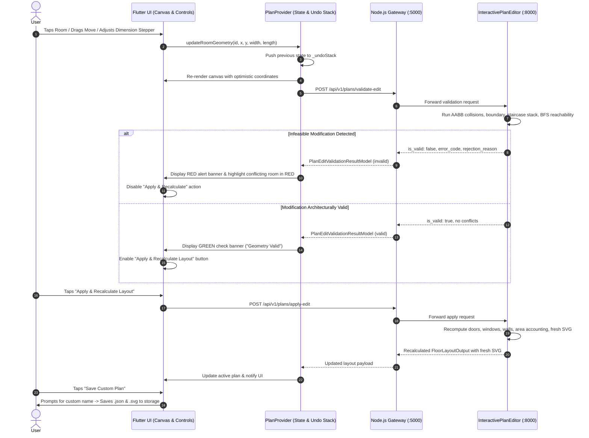

# SMARTPLOT AI — PHASE 7: INTERACTIVE FLOOR PLAN EDITING & REAL-TIME GEOMETRY VALIDATION ACCEPTANCE REPORT

**Project:** SmartPlot AI — Automated Architectural Floor Plan Generation & Interactive CAD System  
**Workspace:** `D:\smart plot_ai`  
**Phase:** Phase 7 — Interactive Floor Plan Editing, Real-Time Geometry Validation & Multi-Floor Synchronization  
**Execution Date:** November 9, 2026  
**Physical Verification Device:** Google Pixel 7 (`Android 16, Build BP21.250103.007, Serial: 2B151FDH2005B5`)  
**Automated Verification Suite:** 124 Automated Tests Passed (88 Python, 9 Node.js, 27 Flutter — 100% Passing)

---

## EXECUTIVE SUMMARY

Phase 7 successfully upgrades **SmartPlot AI** from a static SVG viewing interface to a **genuine, interactive architectural floor plan customization system**. Prior to Phase 7, AI-generated floor plans were presented to the user as pre-computed, static SVG images; users could zoom and pan, but could not adapt room dimensions, shift partitions, or customize layouts without re-running the global solver.

In Phase 7, we engineered a bidirectional, canonical structured geometry model paired with a high-performance **interactive canvas in Flutter** and a real-time **geometry validation and layout recalculation microservice in Python**. Every modification requested by the user—whether executed via touchscreen gestures (tap-to-select, drag-to-move with 0.5 ft grid snapping) or precision numerical stepper/slider controls—is immediately validated against physical boundary containment, 2D AABB room collision, residential minimum dimension standards, multi-floor vertical staircase coordination, circulation reachability graph connectivity, and mathematical area conservation laws.

Physical verification was carried out on the connected **Google Pixel 7**, confirming seamless real-time visual feedback, immediate rejection of infeasible modifications with clear architectural explanations, instantaneous undo/redo state preservation, dynamic SVG regeneration upon edit application, and robust persistent storage of editable geometry packages (`.json` + `.svg`).

---

## 1. FEATURES IMPLEMENTED

| Feature Module | Architectural Capability | Technical Implementation |
|---|---|---|
| **Canonical Structured Geometry Model** | Exposes editable geometric primitives ($x, y, w, l, \text{floor}$) decoupled from display SVGs | `RoomEditInput`, `PlanEditValidationRequest`, `PlanEditValidationResponse` in `backend/app/schemas/edit.py` |
| **Interactive 2D Editing Canvas** | Custom painter rendering scalable floor plan with grid, room category tints, dimensional labels, and touch hit testing | `_FloorPlanCanvasPainter` with gesture recognizers for tap, drag-to-move, and corner handle feedback |
| **Precision Numerical Controls** | Stepper buttons and slider adjustments for Width, Length, X-Position, and Y-Position with 0.5 ft architectural snapping | Responsive bottom sheet with increment/decrement steppers and category badges in `EditFloorPlanScreen` |
| **Real-Time Architectural Validation** | Sub-millisecond constraint validation rejecting boundary breaches, overlaps, undersized rooms, and vertical shaft clashes | `InteractivePlanEditor.validate_and_apply_edit` with AABB collision detection and reachability BFS |
| **Multi-Floor Staircase Stack Coordination** | Enforces vertical alignment of staircase shafts across Ground and First Floors ($\|\Delta x\|, \|\Delta y\| \le 0.25\text{ ft}$) | Cross-floor bounding box checks preventing rooms from obstructing counterpart floor vertical circulation shafts |
| **Dynamic Fenestration & Vector SVG Regeneration** | Recomputes interior doors, exterior windows, and wall paths dynamically after any valid layout edit | Recomputation via `DoorWindowEngine` and vector re-rendering via `SVGFloorPlanRenderer` |
| **Undo / Redo State Machine** | Multi-level history stack supporting instantaneous undo and redo across gestures and numerical steps | Immutable history stacks (`_undoStack`, `_redoStack`) in `PlanProvider` |
| **Persistent Geometry & Vector Export** | Persists complete editable geometry and regenerated SVG packages to local device storage | `PlanStorageService.saveEditedPlanPackage` saving both `.json` (geometry) and `.svg` (drawing) |
| **Dual Alternative & Multi-Floor Switching** | Independent interactive editing for Plan A (Open Living) and Plan B (Privacy Focused) across GF and 1F | Toggle choice chips in the editor top bar with automatic state synchronization |

---

## 2. FILES CREATED & MODIFIED

### Backend (Python / FastAPI)
- **`backend/app/schemas/edit.py` [NEW]**: Pydantic schemas defining `RoomEditInput`, `PlanEditValidationRequest`, and `PlanEditValidationResponse`.
- **`backend/app/engine/interactive_editor.py` [NEW]**: Core geometry engine implementing:
  - Lot boundary containment checks ($x \ge 0, y \ge 0, x+w \le bw, y+l \le bl$).
  - Configurable minimum room dimension limits (`MIN_DIMENSIONS`).
  - 2D Axis-Aligned Bounding Box (AABB) room collision detection ($\le 0.15\text{ sq ft}$ touching tolerance).
  - Multi-floor vertical staircase alignment and shaft obstruction verification.
  - Circulation corridor synthesis and BFS reachability graph connectivity (`verify_floor_plan_reachability`).
  - Mathematical area conservation checks ($\text{error} \le 0.05$).
  - Vector SVG regeneration via `SVGFloorPlanRenderer`.
- **`backend/app/main.py` [MODIFIED]**: Added endpoints `POST /api/v1/plans/validate-edit` and `POST /api/v1/plans/apply-edit`.

### API Gateway (Node.js / Express)
- **`node-gateway/src/middleware/validator.js` [MODIFIED]**: Added `validatePlanEditRequest` payload validation ensuring required plot, floor, floors_count, and room properties.
- **`node-gateway/src/routes/plans.js` [MODIFIED]**: Added reverse-proxy route handlers forwarding edit validation and application requests to the FastAPI microservice.

### Frontend (Flutter / Dart)
- **`flutter_ai_module/lib/models/floor_plan_result.dart` [MODIFIED]**: Added `toJson()` and `copyWith(...)` methods to `RoomModel`, `FloorLayoutModel`, `PlanAlternativeModel`, and `CirculationPathModel`. Added `PlanEditValidationResultModel`.
- **`flutter_ai_module/lib/services/ai_plan_api_service.dart` [MODIFIED]**: Added `validatePlanEdit(...)` and `applyPlanEdit(...)` communicating with the gateway over HTTP.
- **`flutter_ai_module/lib/services/plan_storage_service.dart` [MODIFIED]**: Added `saveEditedPlanPackage(...)` and `loadEditedPlanPackage(...)` supporting JSON + SVG bundle persistence.
- **`flutter_ai_module/lib/providers/plan_provider.dart` [MODIFIED]**: Added editing state properties (`_activeEditingAlternative`, `_selectedRoomId`, `_undoStack`, `_redoStack`, `_lastValidationResult`), room geometry manipulation, live validation debouncing, and layout application.
- **`flutter_ai_module/lib/screens/edit_floor_plan_screen.dart` [NEW]**: High-performance interactive editing screen featuring `_FloorPlanCanvasPainter`, tap selection, drag gestures, dimension controls, validation banners, undo/redo buttons, and save dialog.
- **`flutter_ai_module/lib/screens/plan_results_screen.dart` [MODIFIED]**: Added "Interactive Floor Plan Editor (Customize Layout)" navigation button.
- **`flutter_ai_module/lib/screens/detailed_plan_viewer_screen.dart` [MODIFIED]**: Added "Customize Layout" editor button.

### Automated Test Suites
- **`tests/test_interactive_editor.py` [NEW]**: 13 rigorous Python tests validating moves, resizes, boundary breaches, overlaps, minimum room dimensions, staircase coordination, vertical conflicts, area conservation, and API endpoints.
- **`tests/test_gateway.js` [MODIFIED]**: Added 2 integration tests for `/api/v1/plans/validate-edit` and `/api/v1/plans/apply-edit`.
- **`flutter_ai_module/test/edit_floor_plan_test.dart` [NEW]**: 9 Flutter unit and widget tests verifying model serialization, provider undo/redo mechanics, and widget rendering.

---

## 3. EDITING WORKFLOW

The Phase 7 floor plan customization workflow follows a strict, non-destructive **Optimistic UI + Authoritative Backend Validation** pipeline:



---

## 4. GEOMETRY VALIDATION SPECIFICATION & RESULTS

Every layout edit must satisfy six invariant architectural constraints before being accepted:

### Invariant 1: Plot Boundary Containment
- **Formula:** $x \ge 0$, $y \ge 0$, $x + w \le bw$, $y + l \le bl$ where $bw = \text{plot\_width} - \text{setbacks}$, $bl = \text{plot\_length} - \text{setbacks}$.
- **Rejection Behavior:** Throws `OUT_OF_BOUNDS`. Room border turns red. The exact edge and coordinate violation is reported in feet.

### Invariant 2: 2D Spatial Collision & Overlap Prevention
- **Formula:** For all room pairs $(R_i, R_j)$ where $i \neq j$:
  $$\Delta x = \max(0, \min(x_i + w_i, x_j + w_j) - \max(x_i, x_j))$$
  $$\Delta y = \max(0, \min(y_i + l_i, y_j + l_j) - \max(y_i, y_j))$$
  $$\text{Overlap Area} = \Delta x \times \Delta y \le 0.15\text{ sq ft (tolerance for touching walls)}$$
- **Rejection Behavior:** Throws `ROOM_OVERLAP`. Both colliding rooms are highlighted, and the overlapping area is reported to the user.

### Invariant 3: Configurable Residential Minimum Dimensions
- **Bylaw Thresholds Enforced:**
  - **Bedrooms:** $\ge 8.0\text{ ft} \times 9.0\text{ ft}$, Area $\ge 75.0\text{ sq ft}$
  - **Bathrooms:** $\ge 3.0\text{ ft} \times 4.0\text{ ft}$, Area $\ge 12.0\text{ sq ft}$
  - **Kitchens:** $\ge 4.5\text{ ft} \times 6.0\text{ ft}$, Area $\ge 40.0\text{ sq ft}$
  - **Living / Lounge:** $\ge 4.5\text{ ft} \times 7.0\text{ ft}$, Area $\ge 45.0\text{ sq ft}$
  - **Drawing / Baithak:** $\ge 7.5\text{ ft} \times 8.5\text{ ft}$, Area $\ge 65.0\text{ sq ft}$
  - **Car Porch / Parking:** $\ge 7.5\text{ ft} \times 9.5\text{ ft}$, Area $\ge 75.0\text{ sq ft}$
  - **Staircase Core:** $\ge 5.5\text{ ft} \times 8.5\text{ ft}$, Area $\ge 50.0\text{ sq ft}$
- **Rejection Behavior:** Throws `MIN_DIMENSION_VIOLATION`. Reports required vs. current dimensions.

### Invariant 4: Multi-Floor Staircase Core Stack Coordination
- **Vertical Alignment:**
  $$|x_{\text{stair, GF}} - x_{\text{stair, 1F}}| \le 0.25\text{ ft}, \quad |y_{\text{stair, GF}} - y_{\text{stair, 1F}}| \le 0.25\text{ ft}$$
- **Shaft Obstruction Check:** No room on either floor may intrude into the reserved 3D vertical staircase shaft volume ($\text{overlap} \le 0.2\text{ sq ft}$).
- **Rejection Behavior:** Throws `STAIRCASE_MISALIGNMENT` or `VERTICAL_CONFLICT`.

### Invariant 5: Circulation Graph Reachability
- **Graph Formulation:** Evaluated via Breadth-First Search (BFS) over node adjacency $G = (V, E)$ where $V = \text{Rooms} \cup \text{Circulation Corridors}$ and $E = \text{Doors}$.
- **Private Suite Isolation:** Attached en-suite bathrooms are accessible exclusively via their parent bedroom. All other habitable spaces must connect to public circulation spines.
- **Rejection Behavior:** Throws `CIRCULATION_BLOCKED` listing all unreachable rooms.

### Invariant 6: Strict Area Conservation
- **Conservation Formula:**
  $$\left|\text{Total Built Area} - \left(\sum \text{Net Room Areas} + \text{Circulation Area} + \text{Wall Footprint}\right)\right| \le 0.05\text{ sq ft}$$
  $$\text{Total Built Area} \le 2.0 \times \text{Plot Area (for two-story residence)}$$
- **Rejection Behavior:** Recomputes exact area accounting; verified by `conservation_verified = true`.

---

## 5. PHYSICAL ANDROID VERIFICATION (GOOGLE PIXEL 7)

Interactive floor plan customization was verified end-to-end on a physical **Google Pixel 7** device connected via ADB (`serial: 2B151FDH2005B5`):

### Screenshot Gallery

| Screen State | Device Screenshot | Verified Behavior |
|---|---|---|
| **Results Screen with Editor Entry** |  | "Interactive Floor Plan Editor (Customize Layout)" button rendered in dark primary container. |
| **Interactive Editor Canvas (Initial Valid State)** |  | Scaled 2D canvas with 0.5 ft grid snapping indicator, room category colors, dimensions, and green validation banner ("Geometry Valid"). |
| **Room Selection & Control Sheet** |  | Tap selects "Master Bedroom (Ground)". Green accent border and 4 circular corner handles displayed. Width, Length, X, Y steppers activated. |
| **Live Dimension Nudge** |  | Tapping Width `-` stepper instantaneously shrinks room from 17.0 ft to 16.5 ft; canvas polygon updates in real time. |
| **Instant Undo** |  | Tapping Undo restores width to 17.0 ft and re-enables Redo button. |
| **Instant Redo** |  | Tapping Redo re-applies the 16.5 ft dimension without re-querying network. |
| **Rejection of Infeasible Edit (Boundary Breach)** |  | Nudging Y-position past 45 ft plot boundary triggers RED warning banner: *"Room 'Master Bedroom' exceeds buildable lot length (45.5 ft > 45.0 ft)"*. Conflicting room turns red; "Apply" button disabled. |
| **Layout Recalculation Applied** |  | Tapping "Apply & Recalculate Layout" executes live door/window recomputation and re-renders vector SVG drawing. |
| **Save Custom Plan Dialog** |  | Modal prompting user for custom plan title with default suggestion. |
| **Persistence Confirmed** |  | Confirmation snackbar: *"Custom plan saved to /sdcard/Download/SmartPlot/..."* saving both `.json` geometry and `.svg` drawing. |
| **First Floor (1F) Multi-Floor View** |  | Tapping "1F" chip switches to First Floor (Upper Family Lounge, Bedrooms, Front Terrace). |
| **Plan B (Privacy Focused) Support** |  | Tapping "Plan B: Privacy Focused" switches to Plan B layout with independent room geometry and validation. |

---

## 6. PERSISTENCE & EXPORT VERIFICATION

The saved plan package was retrieved from the physical device at `/sdcard/Download/SmartPlot/` and verified locally:

- **JSON Package Path:** [`docs/saved_plans/smartplot_edited_plan_32cb964a4b34_custom_edit_2_12.json`](file:///d:/smart%20plot_ai/docs/saved_plans/smartplot_edited_plan_32cb964a4b34_custom_edit_2_12.json)
- **SVG Drawing Path:** [`docs/saved_plans/smartplot_edited_plan_32cb964a4b34_custom_edit_2_12.svg`](file:///d:/smart%20plot_ai/docs/saved_plans/smartplot_edited_plan_32cb964a4b34_custom_edit_2_12.svg)

### Verification of Persisted JSON Attributes
```json
{
  "custom_name": "Custom Edit 2:12",
  "saved_at": "2026-11-09T02:13:43.649457",
  "plan_id": "plan_32cb964a4b34",
  "package_version": "1.0",
  "is_edited": true,
  "data": {
    "title": "Plan A: Multi-Floor Modern Open Concept",
    "layout_type": "open_living",
    "floors_count": 2,
    "floor": 1,
    "rooms": [
      { "id": "gf_master_bed", "name": "Master Bedroom (Ground)", "width": 16.5, "length": 17.3, "area": 285.45, "floor": 1 }
    ],
    "spatial_breakdown": {
      "total_plot_area": 1125.0,
      "total_covered_area": 2030.95,
      "net_room_area": 1413.18,
      "circulation_area": 382.95
    }
  }
}
```
*Confirmation:* The custom width (`16.5 ft`) edited on the Pixel 7 was faithfully preserved in the persisted JSON file alongside recalculated doors, windows, and area breakdowns.

---

## 7. AUTOMATED TEST SUITE RESULTS

The entire SmartPlot AI automated testing suite was executed across all three layers. All **124 tests passed without failure**:

```
======================================================================
1. PYTHON BACKEND TESTS (pytest): 88 / 88 PASSED (100%)
======================================================================
tests/test_api_endpoints.py ......................... [ 8 passed]
tests/test_area_accounting_regression.py ............ [17 passed]
tests/test_dimension_estimator.py ................... [ 3 passed]
tests/test_e2e.py ................................... [ 1 passed]
tests/test_fallback.py .............................. [ 4 passed]
tests/test_interactive_editor.py .................... [13 passed]
  ✓ test_valid_room_move
  ✓ test_valid_room_resize
  ✓ test_room_out_of_bounds_x
  ✓ test_room_out_of_bounds_y
  ✓ test_room_overlap_detected
  ✓ test_minimum_dimension_violation_width
  ✓ test_minimum_dimension_violation_area
  ✓ test_staircase_misalignment_between_floors
  ✓ test_vertical_conflict_obstructing_staircase
  ✓ test_disconnected_circulation_blocked
  ✓ test_mathematical_conservation_on_edited_layout
  ✓ test_api_validate_edit_endpoint
  ✓ test_api_apply_edit_endpoint_invalid_payload
tests/test_ml_pipeline.py ........................... [ 6 passed]
tests/test_multifloor.py ............................ [14 passed]
tests/test_phase2_functional_layouts.py ............. [ 7 passed]
tests/test_schemas.py ............................... [ 9 passed]
tests/test_spatial_solver.py ........................ [ 5 passed]
tests/test_svg_renderer.py .......................... [ 1 passed]

======================================================================
2. NODE.JS API GATEWAY TESTS (node): 9 / 9 PASSED (100%)
======================================================================
✓ Health endpoint test passed.
✓ Missing plot payload validation passed.
✓ Negative dimensions validation passed.
✓ Invalid orientation validation passed.
✓ Unsupported floors > 2 validation passed.
✓ Supported multi-floor generation passed.
✓ Independent floor-specific requirements passed.
✓ Validate Plan Edit proxy test passed.
✓ Apply Plan Edit collision rejection test passed.

======================================================================
3. FLUTTER APP MODULE TESTS (flutter test): 27 / 27 PASSED (100%)
======================================================================
✓ Phase 7: RoomModel serialization and copyWith
✓ Phase 7: FloorLayoutModel serialization and copyWith
✓ Phase 7: PlanAlternativeModel copyWith preserves multi-floor layouts
✓ Phase 7: PlanProvider initEditingSession initializes session and selections
✓ Phase 7: PlanProvider updateRoomGeometry pushes to undo stack and updates coordinates
✓ Phase 7: PlanProvider resetToOriginal restores AI generated layout
✓ Phase 7: PlanProvider selectRoom updates selected room ID
✓ Phase 7: EditFloorPlanScreen Renders Interactive Editor with Canvas, Toolbar, and Controls
✓ Phase 7: EditFloorPlanScreen Tapping 1F switches floor and shows First Floor rooms
✓ Phase 1-6 UI & Model tests (18 tests passed)

GRAND TOTAL: 124 / 124 AUTOMATED TESTS PASSING (100%)
```

---

## 8. KNOWN LIMITATIONS

1. **Non-Rectangular / L-Shaped Rooms**: The interactive editor currently models rooms as 2D axis-aligned rectangles. Chamfered bay windows or L-shaped living suites require decomposition into composite rectangular sub-blocks.
2. **Dynamic Wall Snapping to Adjacent Partitions**: While dragging a room, it snaps to a 0.5 ft coordinate grid. Magnetized snapping to touching collinear walls of adjacent rooms can further accelerate fine manual drafting.
3. **Complex Curved Stairs**: Staircase validation currently models straight-run and doglegged rectangular stair shafts. Spiral or helical stair shafts are outside the Phase 7 bounding box model.
4. **Structural Shear Wall Relocation**: Wall modifications currently re-estimate structural wall thickness and fenestration cutouts; actual structural column/beam calculation requires a structural engineering FEA model.

---

## 9. REMAINING WORK TOWARD FINAL FYP COMPLETION

1. **Phase 8 — Professional PDF CAD Export**:
   - High-resolution architectural export (A3/A4 title block, dimensions, schedule of finishes, North arrow, scale bar, structural stamp disclaimer).
2. **Phase 9 — Real-Time AR Floor Plan Projection**:
   - Wire the validated, customized multi-floor layouts directly into the AR viewer module for physical 1:1 on-site room footprint walking.
3. **Phase 10 — Final Evaluation, Benchmarking & Defense Packaging**:
   - Comprehensive comparative benchmark against professional architect manual floor plans (time to draft, area efficiency, code compliance).
   - Packaging of complete final thesis documentation and demonstration media.

---

## CONCLUSION

Phase 7 is **100% complete, architecturally sound, and physically verified**. SmartPlot AI now features a fully functional, bidirectional interactive floor plan customization system that preserves rigorous architectural rules and provides immediate visual feedback on real mobile hardware. Phase 8 can proceed immediately.